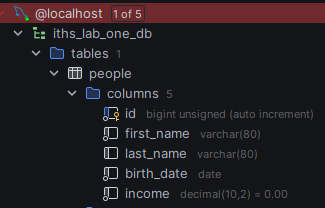
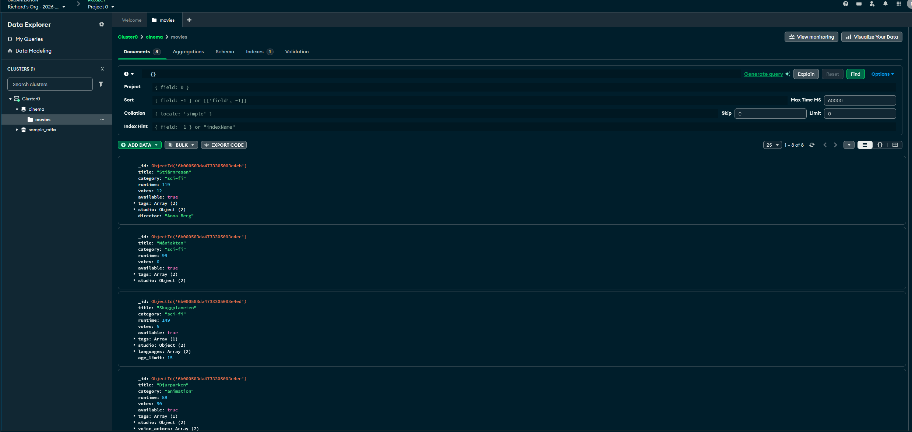
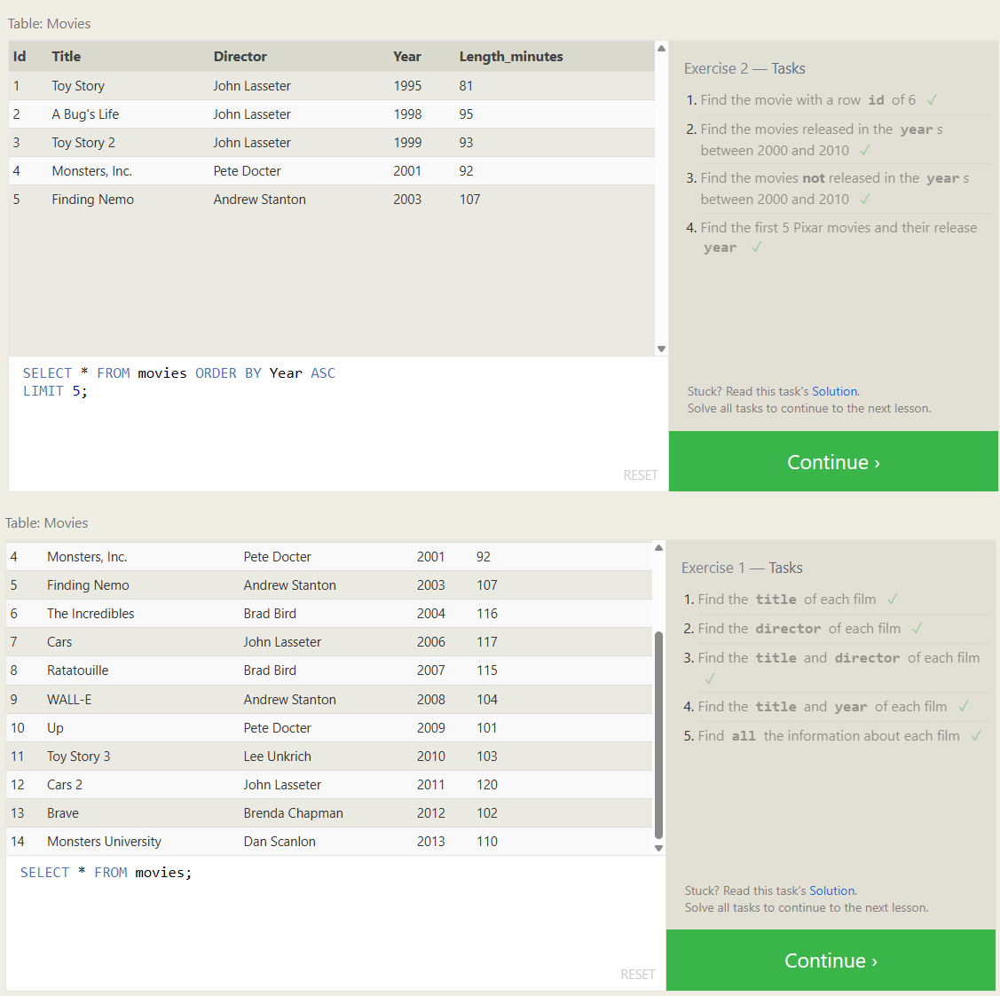

# Labb 1

# MySQL

Skärmdump som visar database explorer i IntelliJ med skapad person-tabell med data:



NOT: Ni ska även ha skapat en user som bara har access till databasen my_database, ingen bild krävs

# MongoDB

Skärmdump av databas på MongoDB Atlas med skapad movie-collection med data:



# SQL

Skärmdump som visar att ni klarat av första två sidorna på sqlbolt.com:s interaktiva tutorial



# Frågor som ni ska svara på (G-nivå)

Besvara frågorna med egna ord. Ge gärna exempel.

## Databaser och verktyg

1. Vad är en databas, och vad kan den användas till?

   En databas används för att lagra och organisera information.
   Som ett exempel använder banker databaser för att lagra konton, användare och liknande.

---

2. Vad används språket SQL till?

   SQL används för att kommunicera med relationsdatabaser.
   Genom SQL kan man lägga till information, uppdatera
   information, ta bort information och hämta information.

## Tabeller och relationer

3. Vad är en tabell, en rad och en kolumn?

   En tabell används för att organisera information i en databas.

   En rad representerar en enskild post till exempel en
   Person med sitt förnamn, efternamn och ålder.

   En kolumn representerar en specifik egenskap hos
   informationen, till exempel förnamn.
   Varje rad har ett värde för den kolumnen.

---

4. Vad är en primärnyckel, och varför behövs den?

   En primärnyckel är ett unikt värde som används för att indentifera varje rad i en tabell.
   Den används även för indexering, vilket gör det snabbare att söka efter information i databasen.
   En primär nyckel säkerställer också att varje rad har ett unikt värde och inte kan ha NULL

---

5. Vad är en främmande nyckel?

   En främmande nyckel är en kolumn som används för att koppla ihop två tabeller. Den referar till en primärnyckel i en
   annan tabell, vilket gör så att det kan relatera information mellan tabeller.
   Ett exempel är att en person ska kunna ha flera email kopplade till sig.

---

6. Varför är det bra att lagra kunduppgifter och köp i olika tabeller?

   Det är bra eftersom att man slipper lagra samma information flera gånger. Istället kan man koppla ihop tabellerna med
   hjälp av kundens ID. Detta gör databasen mer organiserad och enklare att hantera i långsiktigt.

## NoSQL

7. Vad menas med NoSQL, och hur kan information organiseras i en sådan databas?

NoSQL innebär att man använder en databas som inte bygger på traditionella relationella tabeller. Informationen kan
exempelvis organiseras som dokument, nyckel-värde-par eller grafer.
   
---

8. Ge ett exempel på när en NoSQL-databas kan vara lämplig och förklara varför.

En NoSQL databas kan vara lämplig för en chattaplikation eftersom meddelanden kan innehålla olika typer av information
till exempel text, bilder och tidsstämplar. Det gör det enklare att lagra informationen med olika strukturer.

## SQL – hämta data från tabellen person

Skriv en SQL-fråga som svar på varje uppgift.

9. Hämta alla kolumner för alla personer i tabellen.

```sql
   SELECT *
   FROM people;
```

10. Hämta endast förnamn och efternamn för alla personer.

```mysql
   SELECT first_name, last_name
   FROM people;
```

11. Hämta förnamn, efternamn och inkomst för personer med en inkomst över 30 000.

```mysql
   SELECT first_name, last_name, income
   FROM people
   WHERE income > 30000;
```

12. Hämta alla personer födda före den 1 januari 1990.

```mysql
    SELECT *
    FROM people
    WHERE birth_date < '1990-01-01';
```

13. Hämta förnamn, efternamn och inkomst, sorterat efter inkomst från högst till lägst.

```mysql
    SELECT first_name, last_name, income
    FROM people
    ORDER BY income DESC;    
```

14. Räkna hur många personer som finns i tabellen.

```mysql
    SELECT COUNT(*)
    FROM people;    
```

# VG-nivå

Dessa frågor ska besvaras med ett längre svar, minst en halv A4-sida:

1. En banköverföring avbryts efter att pengarna dragits från det första kontot.
   Vad kan konsekvensen bli, och hur kan en transaktion hjälpa?

2. Välj ett enkelt system, antingen en webbutik eller en chatt.
   Resonera om när en relationsdatabas respektive en NoSQL-databas
   kan vara lämplig. Motivera med hur informationen ska lagras och användas.


